  
    

  <!-- Dynamic Typing Sub-bar (duration=3000 + pause=1000 = 4s/line -> 20s total loop synced with header.svg) -->
  

   

  <!-- Quick-Access Contact & Credentials Bar -->
  

    
    
    
  

---

### 🛠️ Engineering Arsenal & Toolchain

  
<b>🧪 Quality Engineering, Test Automation &amp; Load Telemetry</b>

  

    
    
    
    
    
    
  

  
<b>💻 Languages, Systems &amp; Infrastructure</b>

  

    
     
    
  

---

### 🏆 Featured Engineering Projects

<table>
  <tr>
    <td width="50%" valign="top">
      <h4>🛡️ Multi-Product E2E &amp; Automation Suite</h4>
      
Automated web, mobile, API, and stress-testing architecture verifying complex production workflows, database states, and load thresholds at <b>AppifyLab</b>.

      
<code>Playwright</code> <code>Appium</code> <code>TypeScript</code> <code>Grafana k6</code> <code>Postman</code> <code>CI/CD</code>

    </td>
    <td width="50%" valign="top">
      <h4>👁️ Schema Extraction via CV</h4>
      
Computer vision engineering pipeline that converts static database diagrams and ERDs into structured relational models using object detection and image processing.

      
<code>Python</code> <code>YOLO</code> <code>OpenCV</code> <code>Image Processing</code>

    </td>
  </tr>
  <tr>
    <td width="50%" valign="top">
      <h4>📡 DigitalDelta</h4>
      
Offline peer-to-peer disaster response communication system engineered for zero-internet emergency scenarios with decentralized mesh discovery.

      
<code>Flutter</code> <code>Dart</code> <code>P2P Networking</code> <code>Offline-First</code>

    </td>
    <td width="50%" valign="top">
      <h4>🎓 CodeSentrix</h4>
      
Interactive computer science learning platform featuring step-by-step algorithm visualizers, interactive coding environments, and technical curriculum modules.

      
<code>Flutter</code> <code>Dart</code> <code>Mobile App</code> <code>Visualizers</code>

    </td>
  </tr>
</table>

---

### 📊 Telemetry & Contribution Activity

  

 

  <picture>
    <source media="(prefers-color-scheme: dark)" srcset="https://raw.githubusercontent.com/asifbarakat/asifbarakat/main/dist/github-snake-dark.svg" />
    <source media="(prefers-color-scheme: light)" srcset="https://raw.githubusercontent.com/asifbarakat/asifbarakat/main/dist/github-snake.svg" />
    
  </picture>

